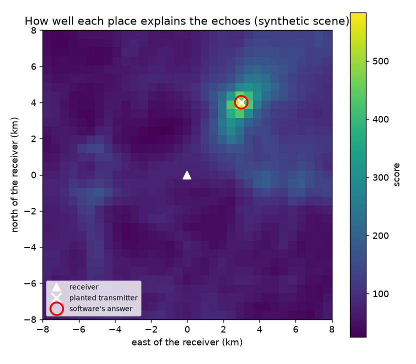

# jamfinder

Find where a VHF radio transmitter is, with one cheap receiver that stands still.
The receiver listens for the faint echoes of the transmitter's signal off passing aircraft.

**Status: a research prototype, closed on 17 November 2026. It is not a product.**
It was never tested on a real interference source, and never on a receiver we owned.
Everything was measured on known, licensed transmitters heard through volunteers' public
receivers, or in simulation. Nobody maintains it. Questions and fixes may go unanswered.

The name is a working name. Nothing in this repository has located a jammer.

## The idea

A transmitter's signal reaches the receiver directly, and also as weak echoes off aircraft.
Each echo arrives a few hertz off the main signal, because the aircraft is moving (Doppler shift).
Public ADS-B data says where every aircraft is and how fast it flies.

So for any place on the map, the software can predict the echo pattern a transmitter standing
there would produce, and compare that with the recording. The place that fits best is the answer.
If no place fits clearly better than a set of deliberately wrong tests, the software says "nothing".

One receiver. No antenna array, no second site, no precise clock. The receiver only listens.
At Helsinki, the best site, the receiver was of the 30 to 40 dollar class. The other sites used
costlier models.

A plain-language explanation is in [docs/how_it_works.md](docs/how_it_works.md).

## Try it in two minutes

No radio and no network are needed. The demo makes a synthetic scene, hides a transmitter in it,
and lets the real search code find it.

    python3.12 -m venv .venv
    .venv/bin/pip install -r requirements.txt
    .venv/bin/python examples/demo_synthetic.py --plot map.png

Expected output:

    scene: 6 aircraft, 10 minutes, transmitter of 10 W planted 5.0 km from the receiver

    1. with aircraft echoes
      verdict: one   (score 984.9; the software answers only above 15.0)
      best spot: 2987 m east, 4020 m north of the receiver
      true spot: 3000 m east, 4000 m north   miss: 24 m
      evidence per aircraft: SIM2 442, SIM5 431, SIM3 431, SIM1 428, SIM0 419, SIM4 260

    2. control: the same scene without echoes
      verdict: nothing   (score 5.4; the software answers only above 15.0)

The demo shows that the chain works and what the output looks like. It does not show how weak a
real transmitter can be. The simulator is trusted to about 5 dB, and real sites are harder.

Run the tests with `.venv/bin/python -m pytest -q`.

## Use it on a real signal

[docs/try_it_yourself.md](docs/try_it_yourself.md) goes through it step by step: pick a target,
record the signal through a network receiver, record the aircraft positions, run the analysis
and read the answer.

## What is in this repository

| Path | What it is |
|---|---|
| `jf/` | The method: signal handling, aircraft tracks, the map search, the reporting rules |
| `sim/` | The simulator that plants a made-up transmitter among aircraft tracks |
| `examples/` | The two-minute demo |
| `tools/` | Recording, repair and screening scripts, and the script that runs the whole analysis |
| `analysis/` | The steps of the analysis, the pictures, and simulations on real aircraft tracks |
| `tests/` | Tests on simulated data |
| `data/`, `results/` | Empty. Your recordings and the outputs of your runs go here. Each has a README. |
| `docs/` | How it works, how to use it, and one line per script |

A one-line description of every script is in [docs/script_index.md](docs/script_index.md).

This is the software and its instructions. The recordings, the result files and the notes of
the experiments behind it are not included.

## What to expect

The demo is an easy scene. This is what four days of tests on real signals gave. The records
behind these numbers are not in this repository, so they cannot be checked from it.

These are the runs in fair conditions. Fair means: an upright AM transmitter such as an airport
weather broadcast, heard at 45 dB-Hz or more, with at least 15 aircraft an hour nearby.

| Site | Runs | Outcome |
|---|---|---|
| Helsinki, receiver 6 km away | 5 | Best spot 11 to 45 m from the reference mast in all five |
| Ottawa, receiver 6 km away | 2 | Best spot 56 m and 36 m from the regulator's listed site |
| Genoa, receiver 10 km away | 1 | Missed. After a software repair the same recording gave 362 m, which does not count as a pass. |
| Manchester, receiver 14 km away | 1 | Missed |

The best spot was within 1 km of the reference in 7 of 9 runs. The software itself said "one
transmitter, here" in 5 of those 7 and withheld the other 2.

Nine more runs were outside fair conditions: weak signals, few aircraft, a short recording,
navigation beacons, one FM station. The software said "nothing" in all nine. One of them is
arguable. The short recording, at Sydney, meets the letter of the fair definition. Counted as
fair it makes 10 runs, 7 found and 3 missed.

Read these numbers with four cautions.

- **The reporting rule is the weak part.** It was rewritten several times on these same
  recordings. Earlier versions gave wrong answers: one at a small airport, 1.4 km from the listed
  site, and several in stress tests. The last version gave no wrong answer on the seven
  recordings made after it was frozen, and it also withheld two right ones.
- **Helsinki's reference is inferred.** It is a mast on OpenStreetMap that we took to be the
  transmitter. The receiver's position was also corrected by a few hundred metres using the
  echoes.
- **Few runs were blind.** Of the nine runs in the table, only the first at Ottawa was analysed
  blind, and it was reported only under a rule written after it. Everywhere else the reference
  position was known when the answer came out.
- **These are cooperative transmitters.** Always on, licensed, at known airports. Their power
  was never confirmed. A real interference source may be none of those things.

## What it cannot do

- It needs aircraft: about 15 an hour within 30 km. Busy airports in daytime, not remote places.
- It needs a steady, narrow carrier that stays on or keeps coming back. The shortest real find
  used 25 minutes of signal, on the recording the method was built on. The shortest under a
  rule frozen in advance used 45 minutes. Single short bursts are out of reach.
- It needs a loud signal at the receiver, about 45 dB-Hz. At both sites where it worked, the
  transmitter was about 6 km from the receiver. At 10 and 14 km it missed. Scaled from one
  site's loudness, that is roughly tens of watts within 10 to 15 km, or 1 W within 4 km. That
  scaling was never measured.
- FM is unproven. Wideband signals, noise-like sources and GPS jammers do not fit the method.
- It cannot locate a transmitter that is itself on an aircraft.
- Two wrong spots were never explained, at Brainerd and at Sydney. The final rule withheld both.
  An earlier rule reported the one at Brainerd.

## Credits

- Aircraft positions: [adsb.fi](https://adsb.fi), [adsb.lol](https://adsb.lol) and the
  [OpenSky Network](https://opensky-network.org), and for two recordings
  [airplanes.live](https://airplanes.live). All are built by volunteers who share their receivers.
- The volunteers who run public software-radio receivers. Every real recording came through one.
  Their receivers were not always used within the limits their owners set. See "Be a polite
  guest" in [docs/try_it_yourself.md](docs/try_it_yourself.md).
- OpenStreetMap contributors, for the Helsinki mast.
- [OurAirports](https://ourairports.com), for airport frequencies and beacon positions.
- The Ottawa reference is from the Canadian regulator's transmitter list. Contains information
  licensed under the
  [Open Government Licence – Canada](https://open.canada.ca/en/open-government-licence-canada).
- The Sydney reference is from the Australian regulator's register. Based on Australian
  Communications and Media Authority information.
- The authors of the earlier work named at the end of
  [docs/how_it_works.md](docs/how_it_works.md).

## Not for safety use

This is research code. An AI coding agent (Anthropic's Claude) wrote it and this documentation,
and neither has had an independent review. Do not use it for anything that people's safety
depends on. Only receive. Follow your country's rules on listening to radio signals.

## Licence

GNU Affero General Public License, version 3 or later. See [LICENSE](LICENSE).
Copyright (C) 2026 the jamfinder authors.
